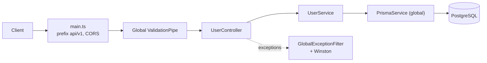

# MeetAi-backend

An early-stage **NestJS 11 + Prisma + PostgreSQL** backend starter. It sets up the basics a REST API needs (validated config, structured logging, request validation, consistent error responses) and exposes a single `User` resource.

> **Status: prototype / boilerplate.**
> Despite the repository name, this service is **not connected to the [Meet.AI](https://github.com/tinhne/meetai) app**. Meet.AI runs its own API inside Next.js (tRPC + Drizzle + Better Auth) and never calls this server.
> The package is named `backend-jwt`. The Prisma schema already models users, sessions and password-reset tokens for a planned JWT auth flow, but no authentication endpoints exist yet.

## Overview

The project was scaffolded with the Nest CLI and is meant as a base for a JWT-authenticated API. So far it contains the infrastructure layer and one example feature module:

- **Config:** `@nestjs/config` with a Joi schema that validates environment variables at startup.
- **Logging:** Winston via `nest-winston`. Output is colorized in development and JSON otherwise.
- **Validation:** a global `ValidationPipe` (whitelist, forbid unknown fields, implicit type conversion).
- **Errors:** a global exception filter that returns a uniform JSON error and maps Prisma error codes to HTTP statuses.
- **Data:** a global `PrismaService` connected to PostgreSQL. PostgreSQL itself runs locally with Docker Compose.
- **Tooling:** ESLint (typescript-eslint, type-checked) + Prettier, Husky + lint-staged pre-commit hook, commitlint (Conventional Commits), Jest + Supertest.

## Key features

- Global route prefix `api/v1` (`src/main.ts`).
- CORS with credentials and an explicit list of methods and headers (`src/main.ts`).
- Environment validation fails fast on startup (`src/config/env.validation.ts`).
- `GlobalExceptionFilter` (`src/common/filters/http-exception.filter.ts`):
  - Returns `{ statusCode, timestamp, path, method, message, error }`.
  - Maps Prisma `P2002` to `409`, `P2025` to `404`, `P2003` to `400`, and validation errors to `400`.
  - Logs 5xx responses as errors and 4xx responses as warnings.
- `PrismaService` connects on module init and disconnects on destroy (`src/infrastructure/database/prisma.service.ts`).
- `User` module with create and list endpoints (`src/modules/user`).

## Tech stack

| Layer | Technology |
| --- | --- |
| Runtime / language | Node.js, TypeScript 5.9 |
| Framework | NestJS 11 (`@nestjs/core` 11.1, Express platform) |
| Config | `@nestjs/config` 4, Joi 18 |
| Database | PostgreSQL 15 (Docker), Prisma 5.22 |
| Validation | class-validator, class-transformer |
| Logging | Winston 3 + nest-winston |
| Testing | Jest 30, ts-jest, Supertest |
| Tooling | pnpm, ESLint 9, Prettier 3, Husky 9, lint-staged, commitlint |

## Architecture



### Data model (`prisma/schema.prisma`)

| Model (table) | Purpose |
| --- | --- |
| `User` (`users`) | email (unique), optional password, first/last name, avatar, `role` (`USER`, `ADMIN`, `MANAGER`), `provider` (`LOCAL`, `GOOGLE`, `GITHUB`) + `providerId`, `isVerified`, soft-delete `deletedAt` |
| `Session` (`sessions`) | per-device refresh-token session (token meant to be stored hashed), user agent, IP, `lastActiveAt`, expiry |
| `PasswordResetToken` (`password_reset_tokens`) | one-time reset token (meant to be stored hashed), expiry, `usedAt` |

Only `User` is used by the code today. `Session` and `PasswordResetToken` are groundwork for the planned auth flow.

## Project structure

```text
src/
├── main.ts                         # bootstrap: prefix, logger, pipes, filter, CORS
├── app.module.ts                   # ConfigModule + Prisma, Logger, User modules
├── config/                         # configuration factory + Joi env schema
├── common/
│   ├── filters/                    # GlobalExceptionFilter
│   └── pipes/                      # GlobalValidationPipe
├── infrastructure/
│   ├── database/                   # PrismaModule / PrismaService (global)
│   └── logger/                     # Winston logger module (global)
└── modules/user/                   # controller, service, DTO, entity
prisma/                             # schema.prisma + migrations
test/                               # e2e test (Supertest)
test-boilerplate/                   # empty Bruno API collection
docker-compose.yml                  # local PostgreSQL 15 on port 5435
```

## Getting started

### Prerequisites

- Node.js 20+ and [pnpm](https://pnpm.io)
- Docker (for the local PostgreSQL container)

### Install

```bash
git clone https://github.com/tinhne/MeetAi-backend.git
cd MeetAi-backend
pnpm install
```

### Start PostgreSQL

```bash
docker compose up -d
```

This starts PostgreSQL 15 on `localhost:5435` with database `nest_db`. The local user and password are defined in `docker-compose.yml`.

### Configure the environment

```bash
cp .env.example .env
```

Fill in the values. `NODE_ENV` is required by the validation schema but missing from `.env.example`, so add it yourself:

```env
NODE_ENV=development
PORT=3000
DATABASE_URL=postgresql://<user>:<password>@localhost:5435/nest_db
JWT_SECRET=your-secret-here
```

### Create the database schema

The committed migrations are older than the current `schema.prisma`. They create `User` and `Session` tables with different columns. Generate a migration that matches the schema:

```bash
pnpm exec prisma migrate dev
```

### Run

```bash
pnpm run start:dev      # watch mode
pnpm run start          # single run
pnpm run build && pnpm run start:prod
```

The API is served at `http://localhost:3000/api/v1`.

### Tests and code quality

```bash
pnpm run test           # unit tests (none exist yet)
pnpm run test:e2e       # e2e tests for /user (needs the database running)
pnpm run lint
pnpm run format
```

## Environment variables

| Name | Required | Description |
| --- | --- | --- |
| `NODE_ENV` | Yes | `development`, `production` or `test` (validated by Joi) |
| `PORT` | No | HTTP port, defaults to `3000` |
| `DATABASE_URL` | Yes | PostgreSQL connection string, used by Prisma |
| `JWT_SECRET` | Yes | Required by validation and loaded into config, but not used yet |

## API reference

| Method | Path | Auth | Description |
| --- | --- | --- | --- |
| POST | `/api/v1/user` | None | Create a user. Body: `{ "name": string, "email": string }`. `name` is stored as `firstName` |
| GET | `/api/v1/user` | None | List all users |

## Known limitations

- **Not the Meet.AI backend.** The repository name suggests it is, but there is no integration with the Meet.AI app.
- No authentication yet: `JWT_SECRET` is unused, and both endpoints are public. `GET /user` returns every column, including `password`.
- `src/main.ts` reads `nodeEnv` and `app.frontendUrl` from config, but `src/config/configuration.ts` defines neither. As a result:
  - The app always behaves as development.
  - CORS reflects any origin (with credentials).
  - Logs always use the development format.
- The committed migrations do not match `schema.prisma`, so run `prisma migrate dev` first (see above).
- The startup log mentions Swagger docs at `/api/docs`, but Swagger is not installed.
- There are no unit tests. The single e2e spec needs a live database.

## Author

**Lê Văn Trung Tính** — Software Engineer | AI Product Builder

- Website: [trungtinh.site](https://trungtinh.site)
- GitHub: [@tinhne](https://github.com/tinhne)
